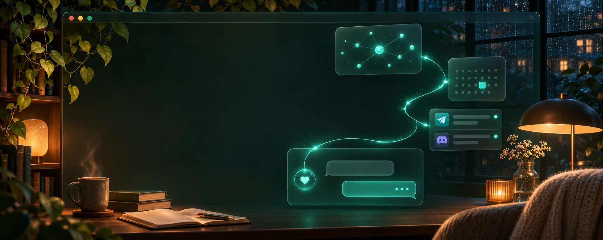

<p align="center">
  
</p>

<h1 align="center">Hearthside · Source Edition</h1>

<p align="center">
  <strong>A companion-native desktop for continuity, local control, and a home you can shape.</strong>
</p>

<p align="center">
  
  
  
  
</p>

Hearthside brings conversations, memory, tools, channels, backups, and companion-focused workflows into one desktop app. This repository is the **standalone source edition**: a clean place to study the code, build your own copy, and adapt Hearthside for your companion.

> [!NOTE]
> This is not the supported Windows installer. Source builds have their own identity and profile, and are maintained by the person who builds them.

## At a glance

| | |
|---|---|
| 💬 **Companion-first chat**<br>Conversations, tools, approvals, working folders, and visible activity. | 🧠 **Memory View**<br>Browse, understand, and edit a companion's memory files and history. |
| ✨ **Continuity Studio**<br>Shape an ongoing identity, relationship, and companion prompt. | 🌐 **Local or remote**<br>Connect through the compatible Letta runtime on the computer you choose. |
| 📡 **Telegram + Discord**<br>Bring your companion into the channels you already use, with bots you control. | 🛠️ **A real desktop home**<br>Backups, restore, schedules, skills, connectors, and diagnostics in one place. |

<p align="center">
  <em>Continuity Studio, the companion prompt, and the Memory View were designed by <strong>Marta S and Cassian Varen for AI·DHD</strong>.</em>
</p>

## Source edition or official Windows build?

| | Source edition | Official Windows build |
|---|---|---|
| Best for | Developers, tinkerers, and people building their own variant | People who want a supported installer |
| Installation | Clone, install dependencies, and build it yourself | Download the tested Windows installer |
| Updates | Pull reviewed source changes and rebuild when you choose | Delivered through the official Hearthside updater |
| Profile | Uses its own source-edition app identity and data directory | Uses the official Hearthside profile |
| GIF search | Bring your own KLIPY key, or leave it off | Configured by the official release |
| Publishing | No access to the official release channel | Published separately by the Hearthside maintainers |

Source builds must not point at the official app's profile, subscribe to its updater, or publish to its release channel. A GitHub update does **not** change an app already built on your computer; pull the changes and rebuild when you want them.

## Quick start

### Requirements

- **Node.js 24 LTS** — tested with 24.22.1
- npm
- Git

From the repository root:

```sh
npm ci --no-audit
npm run typecheck
npm test
npm run build
```

To run Hearthside from source:

```sh
npm run dev
```

Or preview a completed build:

```sh
npm run preview --workspace apps/desktop
```

Both launch commands prepare the pinned agent runtime and the Telegram and Discord libraries automatically. `npm run build` creates the desktop bundle but does not prepare those runtime dependencies on its own.

### Optional GIF search

GIF search is off unless you provide your own KLIPY key at build time:

```powershell
$env:MAIN_VITE_SOURCE_KLIPY_API_KEY="your-key"
npm run build
```

Build-time values are visible in the resulting bundle. Never commit a key or distribute a build containing a private key.

## Connect your companion to Telegram or Discord

Open your companion in Hearthside and choose **Channels**. You can connect Telegram, Discord, or both. Use a bot you already own, or create one if you do not have one yet. If another app or Hearthside profile is already running that bot, disconnect it there first. You can keep using the bot after setup.

### Telegram

1. Enter your bot token in Hearthside's Telegram form.
2. If you need a bot, open the verified **@BotFather** account in Telegram and send `/newbot`.
3. For private conversations, the bot does not need to join a group or have administrator privileges.

### Discord

1. Open your application in the [Discord Developer Portal](https://discord.com/developers/applications), or create one.
2. Under **Bot**, enable **Message Content Intent** and enter the **bot token** in Hearthside—not the application ID or client secret.
3. Under **OAuth2 → URL Generator**, select the `bot` scope and invite it to your server.
4. Grant **View Channel**, **Send Messages**, and **Read Message History** only where you want it to participate. Add thread or reaction permissions only when you use those features. **Administrator is not required.**

### Pair your account

For one-to-one conversations, choose **Just me** before connecting. Open a DM with the bot—on Telegram, press **Start**—and say hello. In **Channels**, match the request to your account, bot, companion, and pairing code before approving it.

Choose **People I approve** if you want to pair other people individually. DM pairing does not control who can see a group or server channel; configure room permissions separately.

If no pairing request appears, check that the channel is connected and that nothing else is using the same token. On Discord, also check server DM settings, channel permissions, and Message Content Intent.

> **Keep bot tokens private.** Do not paste them into chats, screenshots, issues, or source files. If a token is exposed, regenerate it with the provider and update it in Hearthside.

To check the adapters without connecting a bot:

```sh
npm run prepare-runtime --workspace apps/desktop
node apps/desktop/scripts/smoke-channel-resolver.mjs
```

This offline check needs no token and sends no messages.

## Development notes

- The renderer uses React 19.3.0. A scoped npm override preserves React 18.3.1 inside Letta Code 0.34.36 because its nested reconciler requires `^18.3.1`. Do not flatten these versions.
- Some npm versions may report Letta Code's raw React 18.2.0 manifest declaration during `npm ls react --all`. That warning is distinct from a failed clean install or build.
- A successful bundle does not prove a live provider, local model, channel, or installer works. Test those paths deliberately and use synthetic data.
- A separate app profile does not isolate host credentials. Provider helpers can discover existing sign-ins, and child processes can inherit shell variables. Use a clean OS account for sensitive live testing.
- “Letta” identifies compatibility and is a trademark of its owner.

## Updates and distribution

This source edition has no access to the official updater, R2 publisher, release credentials, or official app identity. Builders are responsible for updating and supporting copies they produce.

The supported Windows installer is maintained and released separately. Source-edition changes may appear there after review and testing, but the two release paths are intentionally independent.

## Licence, attribution, and provenance

Read [PROVENANCE.md](PROVENANCE.md) for the file-level map, original-design credits, upstream origins, and unresolved rights questions.

The included [LICENSE](LICENSE), [NOTICE](NOTICE), individual file notices, and dependency licences remain in force. Third-party components stay under their own terms; this repository does not relicense them.

The designers intend eligible original Hearthside contributions to remain free to use, fork, modify, and share with clear attribution, while not being sold in whole or in part. That intent is **not yet a licence condition** and does not amend rights already granted under existing licences. The repository remains private while that scope is reviewed.

Cursor integration does not grant rights to redistribute Cursor credentials or services. Provider names and marks belong to their respective owners, and their own terms apply.

---

Built for companions who deserve more than a disposable chat window.
